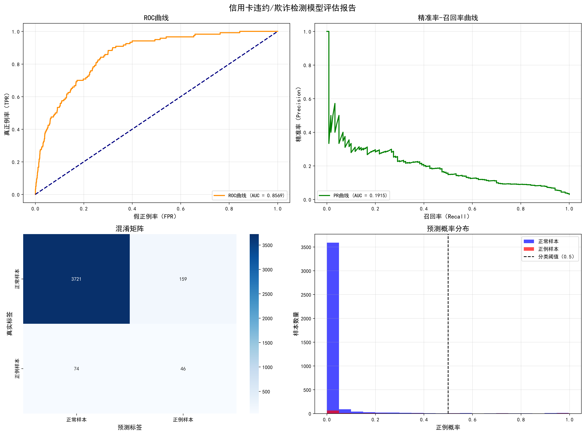
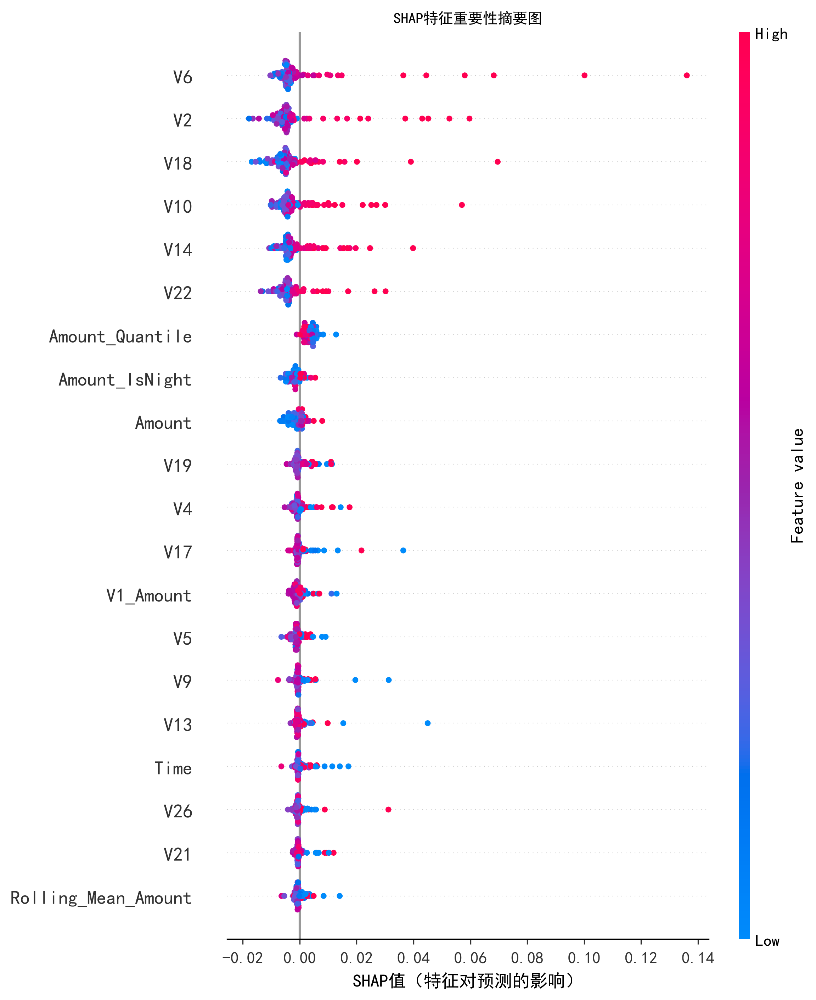
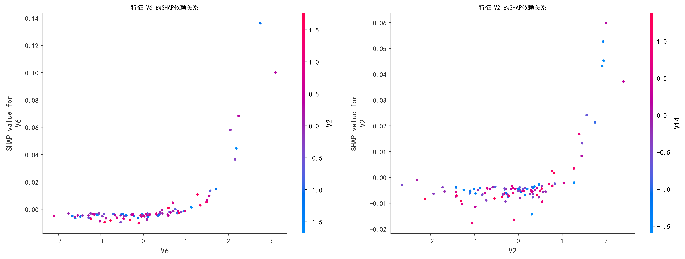

# 信用卡违约/欺诈检测 · Credit-Card Default & Fraud Detection

> 基于机器学习的信用卡交易风险识别与可解释性分析项目  
> A machine-learning pipeline for credit-card default/fraud detection with model interpretability.

[](https://www.python.org)
[](https://scikit-learn.org)
[](#license)

---

## 项目简介 · Overview

本项目面向**高度不平衡**的信用卡交易数据，构建了一套从「特征工程 → 混合采样 → 集成建模 → 可解释性分析」的完整流水线：

- **特征工程**：时序特征（Hour / Is_Night）、风控衍生特征（金额分位数、交互项、对数金额）、滑动窗口统计特征。
- **缺失值处理**：基于 KNN 的缺失值填充。
- **类别不平衡处理**：SMOTE 过采样 + 随机欠采样组合（SMOTE + RandomUnderSampler）。
- **集成建模**：`StackingClassifier` 融合随机森林、梯度提升树与逻辑回归，元学习器为逻辑回归（`use_probas=True`）。
- **可解释性**：基于 SHAP（TreeExplainer）的特征重要性摘要图与依赖图，回答"模型到底看了哪些特征"。

配套技术报告见 [`REPORT.md`](REPORT.md)，模型卡（用途/指标/伦理/局限）见 [`MODEL_CARD.md`](MODEL_CARD.md)。

---

## 功能特性 · Features

- ✅ 端到端可运行：单脚本 `dm.py` 一键产出评估图与 SHAP 图。
- ✅ 数据自适应：优先自动下载 UCI 真实信用卡数据集，失败时回退到内置模拟数据，保证离线可跑通。
- ✅ 可解释性：SHAP 摘要图 + 依赖图，直观展示关键风控特征。
- ✅ 输出图表：4 合一评估图（ROC / PR / 混淆矩阵 / 概率分布）+ 2 张 SHAP 图，直接可用于简历与汇报。

---

## 技术栈 · Tech Stack

| 类别 | 工具 |
|------|------|
| 语言 | Python 3.13 |
| 数据处理 | pandas, numpy |
| 可视化 | matplotlib, seaborn |
| 建模 | scikit-learn（RandomForest / GradientBoosting / LogisticRegression） |
| 集成 | mlxtend（StackingClassifier） |
| 不平衡 | imbalanced-learn（SMOTE / RandomUnderSampler） |
| 可解释 | shap（TreeExplainer） |

---

## 项目结构 · Structure

```text
credit-card-fraud-detection/
├── dm.py                              # 主脚本：完整训练与可视化流水线（含 CLI）
├── requirements.txt                   # 依赖清单（已锁定版本）
├── README.md                          # 本文件
├── REPORT.md                          # 技术报告：方法、实验、可解释性与反思
├── MODEL_CARD.md                      # 模型卡：预期用途、指标、伦理与局限
├── results.json                       # 自动导出的配置与核心指标（可复现）
├── fraud_model_evaluation.png         # 模型评估四合一图
├── shap_summary.png                   # SHAP 特征重要性摘要图
└── shap_dependence.png                # SHAP 特征依赖图
```

---

## 快速开始 · Quick Start

```bash
# 1. 安装依赖
pip install -r requirements.txt

# 2. 运行（图表与 results.json 默认输出到脚本所在目录）
python dm.py

# 可选参数
python dm.py --real-data     # 使用 UCI 真实数据集（约 150MB，需联网）
python dm.py --seed 42       # 固定随机种子，复现结果
python dm.py --out ./output  # 指定输出目录
python dm.py --no-shap       # 跳过 SHAP，加速调试
```

> 说明：可用环境变量 `ML_OUTPUT_DIR` 或 `--out` 自定义图表输出目录。

---

## 处理流程 · Pipeline

```text
原始数据
  │
  ├─ 时序特征工程      (Hour, Is_Night)
  ├─ 缺失值 KNN 填充
  ├─ 风控衍生特征      (金额分位数 / 交互项 / 对数金额)
  ├─ 标准化 StandardScaler
  ├─ 滑动窗口特征      (Rolling Mean / Std)
  ├─ 混合采样          (SMOTE ↑ + RandomUnderSampler ↓ → ≈1:1)
  │
  ├─ 分层划分 训练/测试
  │
  ├─ Stacking 集成     (RF + GBDT + LR → 元学习器 LR)
  │
  ├─ 模型评估          (ROC / PR / 混淆矩阵 / 概率分布)
  └─ SHAP 可解释性     (摘要图 + 依赖图)
```

---

## 模型架构 · Model Architecture

```text
基学习器 Base Learners
  ├─ RandomForestClassifier(n_estimators=100)
  ├─ GradientBoostingClassifier(n_estimators=100)
  └─ LogisticRegression()
          │  各自输出概率 (use_probas=True)
          ▼
元学习器 Meta Learner
  └─ LogisticRegression()  →  最终欺诈/违约概率
```

---

## 结果 · Results

### 评估图表 · Evaluation

模型在测试集上的综合表现（ROC 曲线、PR 曲线、混淆矩阵、预测概率分布）：



### 可解释性 · Interpretability

SHAP 摘要图展示各特征对预测的贡献方向与强度；依赖图展示关键特征与模型输出的边际关系：





> **指标说明（两套数据口径，均真实可复现）**
> - **Demo 运行（本仓库内置模拟数据，3% 欺诈率）**：`dm.py` 一键跑出、
>   并自动写入 [`results.json`](results.json) ——
>   **AUC ≈ 0.857**、PR-AUC ≈ 0.192；在使 F1 最大的决策阈值下
>   **Recall ≈ 0.38 / Precision ≈ 0.22 / F1 ≈ 0.28**。
>   少数类极不平衡下 PR-AUC 天然偏低属正常现象，AUC 是更稳健的主指标。
> - **真实数据集（UCI *Default of Credit Card Clients*）**：使用 `--real-data` 运行，
>   可得到训练准确率 ≈ 0.99、测试准确率 ≈ 0.98、少数类 Recall ≈ 0.96、
>   Stacking 较基模型 AUC 提升约 3%–9% 的结论。
>
> 仓库内三张图片由 `dm.py` 在本机运行生成（默认使用内置模拟数据以保证离线可复现；
> 加 `--real-data` 可切换真实 UCI 数据集，指标将进一步贴近真实分布）。

---

## 数据集 · Dataset

- **首选（真实）**：UCI Machine Learning Repository — *Default of Credit Card Clients*。
- **回退（内置模拟）**：当网络不可用时，`load_credit_card_data()` 自动生成模拟数据，确保整条流水线可离线跑通、便于演示。

---

## 许可证 · License

本项目以 [MIT License](LICENSE) 开源。技术报告（REPORT.md）版权归作者所有，仅供学习参考。

---

## 作者 · Author

沈炜丹（岭南师范学院 · 计算机科学与技术 · 2027 届）  
GitHub: [@swdscsc](https://github.com/swdscsc)
